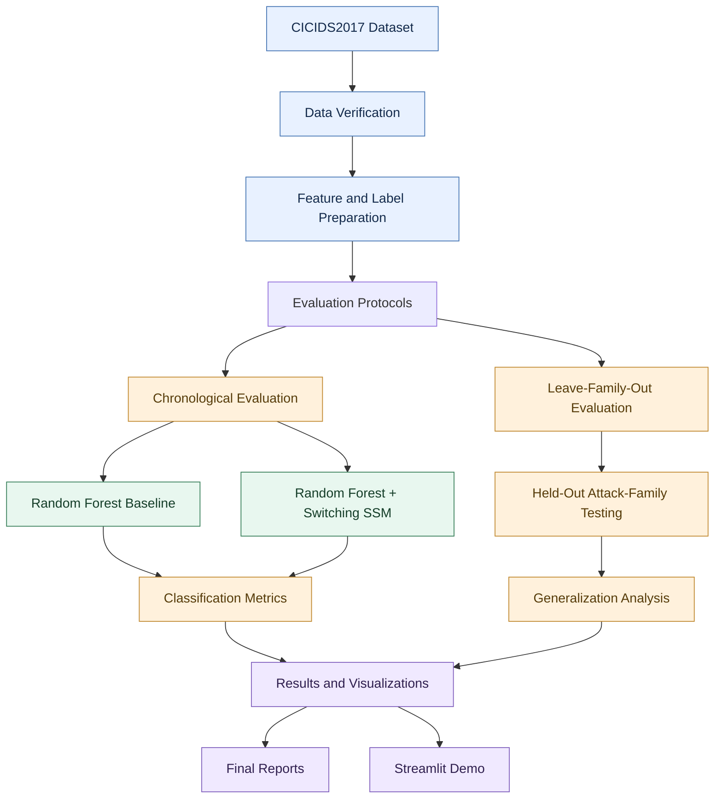
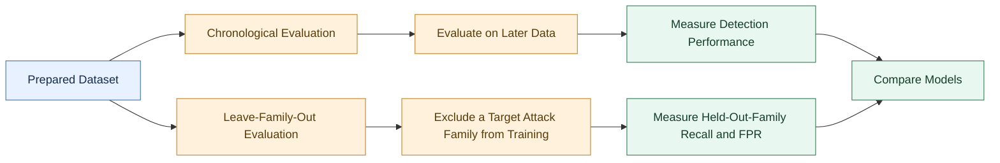
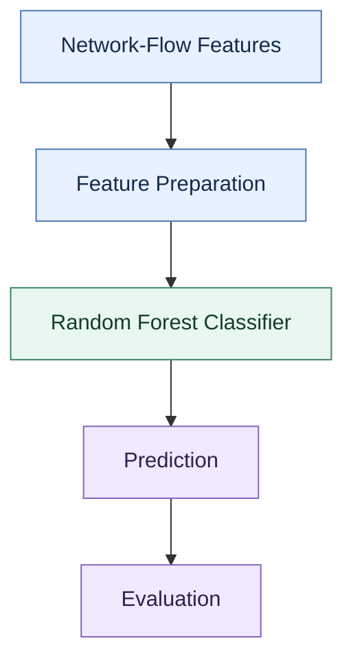
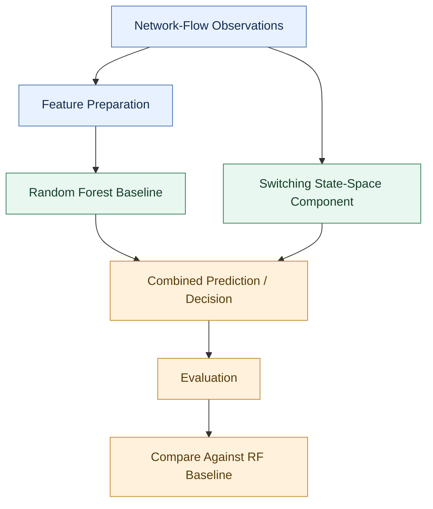
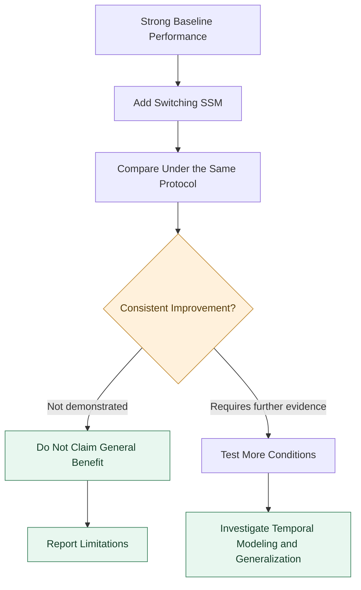
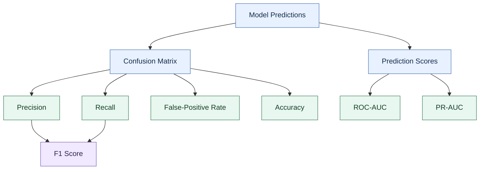

<div align="center">

# PARD-V2

### Evaluating Temporal Network Intrusion Detection and Generalization to Unseen Attack Families

**A reproducible investigation of Random Forest baselines and Switching State-Space Models for network intrusion detection.**

<br>


**Research · Network Security · Temporal Evaluation · Generalization**

</div>

---

## Overview

PARD-V2 investigates whether temporal modeling can improve network intrusion detection beyond a conventional machine-learning baseline.

The project compares a **Random Forest (RF)** classifier with an augmented **Random Forest + Switching State-Space Model (SSM)** approach using the CICIDS2017 intrusion-detection dataset.

Rather than relying exclusively on conventional classification metrics, the experiments examine performance under different evaluation settings, including chronological evaluation and leave-family-out (LFO) testing.

The central research question is:

> Does adding a temporal state-space component improve intrusion detection, particularly when the evaluation becomes more challenging and attack families differ from those observed during training?

The results show that the Random Forest baseline performs strongly in-distribution. However, the SSM addition does not consistently improve performance, and generalization to unseen attack families remains a significant challenge.

### At a glance

| Component             | Description                                   |
| --------------------- | --------------------------------------------- |
| Research domain       | Network intrusion detection                   |
| Dataset               | CICIDS2017                                    |
| Verified dataset rows | 2,830,743                                     |
| Baseline              | Random Forest                                 |
| Proposed comparison   | Random Forest + Switching SSM                 |
| Evaluation settings   | Chronological and leave-family-out            |
| Main metrics          | Precision, recall, F1, ROC-AUC, PR-AUC, FPR   |
| Demo framework        | Streamlit                                     |
| Primary objective     | Evaluate temporal modeling and generalization |

---

## Contents

* [System Architecture](#system-architecture)
* [Research Objectives](#research-objectives)
* [Dataset and Experimental Design](#dataset-and-experimental-design)
* [Model Architecture](#model-architecture)
* [Results](#results)
* [Generalization to Unseen Attack Families](#generalization-to-unseen-attack-families)
* [Understanding the SSM Contribution](#understanding-the-ssm-contribution)
* [Evaluation Metrics](#evaluation-metrics)
* [Demo](#demo)
* [Installation](#installation)
* [Repository Structure](#repository-structure)
* [Reproducibility and Limitations](#reproducibility-and-limitations)
* [Future Directions](#future-directions)

---

## System Architecture

The experimental workflow starts with CICIDS2017 data verification and proceeds through evaluation-split construction, model training, testing, and results analysis.



*The diagram describes the experimental design, not a claim that the SSM improves detection.*

### End-to-end workflow

1. **Verify the data:** inspect the dataset structure, labels, duplicates, and consistency.
2. **Prepare evaluation protocols:** construct the splits required for chronological and unseen-family evaluation.
3. **Train the models:** establish a Random Forest baseline and evaluate the SSM-augmented alternative.
4. **Measure performance:** calculate classification metrics and inspect errors.
5. **Analyze generalization:** evaluate performance on attack families excluded from training.
6. **Present the results:** generate plots, summaries, and assets for the interactive demo.

---

## Research Objectives

PARD-V2 is organized around four questions.

### 1. How strong is the conventional baseline?

Establish the performance of a Random Forest classifier before attributing any improvement to a temporal model.

### 2. Does adding an SSM improve detection?

Compare the baseline and augmented model under the same reported in-distribution evaluation setting.

### 3. Does performance generalize to unseen attack families?

Use leave-family-out testing to examine whether a model trained on other families can detect attacks from a held-out family.

### 4. What do the evaluation protocols reveal?

Distinguish strong performance on the evaluated distribution from the ability to handle unfamiliar attack patterns.

---

## Dataset and Experimental Design

### Dataset

The project uses **CICIDS2017**, a network traffic dataset designed for intrusion-detection research.

| Dataset property                              | Verified information |
| --------------------------------------------- | -------------------: |
| Total rows                                    |            2,830,743 |
| Duplicate rows identified during verification |               66,945 |
| Columns, including label                      |                   79 |
| Feature columns in the demo model             |                   69 |

The counts above describe the dataset verification and demo-model configuration, respectively. The 69-feature demo model should not be interpreted as evidence that every experiment used an identical feature configuration.

**Important:** The original raw dataset is not included in this repository. Obtain the dataset from its official source and follow its applicable terms.

### Experimental design



#### Chronological evaluation

Chronological evaluation aims to test performance on later observations rather than relying solely on a randomly shuffled split.

This matters because random splits can place similar or related observations in both training and test sets, potentially producing an overly optimistic picture of performance under changing traffic conditions.

**Timestamp caveat:** Where verified event timestamps were unavailable, row order was used as a proxy for time. Row order alone does not establish real-world temporal ordering, so results from such splits should be interpreted accordingly.

#### Leave-family-out evaluation

Leave-family-out (LFO) testing evaluates a model on a target attack family that was excluded from its training data.

This tests a different capability from ordinary classification: whether a detector trained on other attack patterns can recognize an unfamiliar family.

High accuracy on familiar traffic does not guarantee strong performance in this setting.

---

## Model Architecture

PARD-V2 compares two approaches.

### Model A — Random Forest baseline

The baseline uses a Random Forest classifier to learn relationships between network-flow features and the target labels.



**Purpose:** Establish a strong conventional machine-learning reference point.

### Model B — Random Forest + Switching SSM

The augmented approach investigates whether a switching state-space component can contribute useful information beyond the baseline.



*This is a conceptual diagram of the model comparison. It is not a specification of every internal state transition, fusion rule, or inference step.*

The central experimental requirement is to determine whether the SSM adds measurable value, rather than assuming that introducing a temporal component necessarily improves detection.

---

## Results

### In-distribution performance

The following values are from the reported per-episode in-distribution results.

| Metric              | Random Forest | RF + SSM | Interpretation           |
| ------------------- | ------------: | -------: | ------------------------ |
| ROC-AUC             |        0.9970 |   0.9970 | No reported change       |
| PR-AUC              |        0.9955 |   0.9955 | No reported change       |
| Recall              |        0.9950 |   0.9950 | No reported change       |
| False-positive rate |        0.0103 |   0.0110 | Slightly higher with SSM |
| Precision           |        0.9311 |   0.9268 | Lower with SSM           |
| F1 score            |        0.9620 |   0.9597 | Lower with SSM           |
| Accuracy            |        0.9903 |   0.9897 | Lower with SSM           |

### Key observations

* The Random Forest baseline already achieves strong in-distribution performance.
* ROC-AUC, PR-AUC, and recall are unchanged at the reported precision.
* The SSM-augmented model has a slightly higher false-positive rate.
* Precision, F1, and accuracy are marginally lower for the augmented model in this evaluation.
* These results do not establish a consistent in-distribution benefit from adding the SSM.

The reported metrics are specific to this evaluation. They should not be generalized to every attack family, traffic distribution, or deployment environment.

### Visual 1 — Confusion matrices by episode


*Use this plot to inspect the distribution of true positives, true negatives, false positives, and false negatives across the evaluated episodes.*

### Visual 2 — Held-out attack-family performance


*This plot highlights performance under the leave-family-out evaluation protocol.*

### Visual 3 — Recall across attack families


*Compare performance across attack families rather than relying on a single aggregate metric.*

### Visual 4 — SSM contribution


*Inspect where the SSM-augmented approach improves or degrades performance relative to the baseline.*

### Visual 5 — Confusion counts


The confusion-count artifact above is a CSV file rather than an image. To display it visually in the README, generate a chart from the CSV and commit the resulting PNG.

Recommended output path:

`results/final_20261028_172705_final/confusion_counts.png`

### Visual 6 — Incident detection


*Use this visualization to examine the incident-detection behavior represented by the experiment.*

> **Image-path note:** The README references result artifacts reported in the project context. Confirm each file exists at the exact path and is tracked by Git before publishing. GitHub cannot render an image from a CSV file; replace the confusion-count CSV reference with a generated PNG as noted above.

---

## Generalization to Unseen Attack Families

One of the most important aspects of PARD-V2 is the distinction between performance on familiar attack patterns and performance on held-out families.

In the reported leave-family-out results, the baseline showed very low recall for some held-out attack families:

| Evaluation case          | Reported baseline recall |
| ------------------------ | -----------------------: |
| Held-out Bot family      |                    0.000 |
| Held-out PortScan family |      Approximately 0.021 |

These values indicate that strong aggregate performance does not guarantee detection of every unseen attack family.

The results should be interpreted in the context of the specific held-out protocol, features, training data, and test observations. They do not establish that all unseen attacks are undetectable.

### Why this matters

A detector may perform well when training and testing involve similar attack distributions yet struggle when the test set contains a family it has never seen.

That distinction matters for cybersecurity systems expected to operate in environments where attack behavior changes over time.

**Research takeaway:** Generalization should be evaluated directly; it cannot be inferred from high accuracy or ROC-AUC alone.

---

## Understanding the SSM Contribution

The purpose of the SSM experiment is to test whether a state-space component contributes useful information beyond the Random Forest baseline.

The current reported evidence does not justify claiming that the SSM consistently improves intrusion detection.



A useful next step is to investigate whether the SSM's state estimates, transition behavior, or integration with the baseline provide benefits under specific conditions that the current aggregate results do not capture.

Any such benefit would need to be demonstrated experimentally.

---

## Evaluation Metrics

PARD-V2 uses multiple metrics because no single score fully describes an intrusion detector.

| Metric              | What it measures                                      | Why it matters                                          |
| ------------------- | ----------------------------------------------------- | ------------------------------------------------------- |
| Precision           | Fraction of predicted attacks that are actual attacks | Helps assess false alerts                               |
| Recall              | Fraction of actual attacks detected                   | Measures missed attacks                                 |
| F1 score            | Harmonic mean of precision and recall                 | Balances precision and recall                           |
| ROC-AUC             | Ranking performance across classification thresholds  | Measures separation across thresholds                   |
| PR-AUC              | Precision-recall performance                          | Useful when class imbalance matters                     |
| False-positive rate | Fraction of benign examples incorrectly flagged       | Helps quantify unnecessary alerts                       |
| Accuracy            | Fraction of all predictions that are correct          | Useful, but potentially misleading with imbalanced data |

### Metric relationships



Using these metrics together helps distinguish missed attacks, false alerts, and aggregate classification quality.

---

## Demo

PARD-V2 includes a Streamlit demo intended to make the model and its results easier to explore.

**Entry point:** `demo/app.py`

To launch the demo locally:

```powershell
streamlit run demo/app.py
```

### Suggested screenshots

For a more polished GitHub landing page, capture actual screenshots of the working application and add them to the repository.

Recommended assets:

| Screenshot                 | Suggested file                       |
| -------------------------- | ------------------------------------ |
| Main application interface | `docs/images/demo-overview.png`      |
| Prediction output          | `docs/images/prediction-example.png` |
| Results and metrics        | `docs/images/results-dashboard.png`  |
| Evaluation comparison      | `docs/images/model-comparison.png`   |

Once these images exist, embed them using relative paths:

```markdown
## Application Preview


```

These are suggested asset names, not claims that screenshots already exist. Use genuine screenshots from the running application rather than illustrative screenshots presented as actual results.

---

## Installation

### Requirements

* Python 3.10 or a compatible Python version
* Git
* The project repository
* Dataset files, if rerunning experiments that require the original data

### 1. Clone the repository

```powershell
git clone https://github.com/PeerAhammad/PARD-V2.git
cd PARD-V2
```

### 2. Create a virtual environment

```powershell
python -m venv .venv
```

### 3. Activate the environment

```powershell
.\.venv\Scripts\Activate.ps1
```

If PowerShell blocks activation, follow the Python environment instructions appropriate for your system rather than changing machine-wide execution settings unnecessarily.

### 4. Install the demo and experiment dependencies

```powershell
python -m pip install --upgrade pip
python -m pip install numpy pandas scikit-learn hmmlearn joblib streamlit matplotlib pyarrow
```

### 5. Launch the demo

```powershell
streamlit run demo/app.py
```

If an installed dependency version differs from the environment used for the experiments, results or compatibility may vary. For stronger reproducibility, pin and commit the exact dependency versions used by the project.

---

## Repository Structure

The following is a logical overview of the main project components. Confirm the current directory names against the repository before treating it as a complete file listing.

```text
PARD-V2/
│
├── demo/
│   └── app.py
│
├── reports/
│   ├── protocol_v1.md
│   └── split_summary_v1.md
│
├── results/
│   └── final_20261028_172705_final/
│       ├── final_summary.csv
│       ├── final_metrics_per_seed.csv
│       ├── final_family_recall.csv
│       ├── final_block_bootstrap_ci_seed0.csv
│       ├── confusion_counts_mean_over_seeds.csv
│       ├── confusion_lfo_base.png
│       ├── confusion_per_episode.png
│       ├── family_recall_test.png
│       ├── incident_detection.png
│       ├── lfo_recall_fpr.png
│       └── ssm_minus_base.png
│
├── src/
│   ├── phase1_checks.py
│   ├── phase1_splits.py
│   ├── phase2_baselines.py
│   ├── phase2_plots.py
│   ├── phase2b_leave_family_out.py
│   ├── phase3_temporal.py
│   ├── phase4_ssm.py
│   ├── phase5_final_test.py
│   ├── phase5_plots.py
│   ├── build_demo_assets.py
│   └── make_test_csv.py
│
└── phase1_verify.py
```

### Important artifacts

| Artifact                             | Purpose                                          |
| ------------------------------------ | ------------------------------------------------ |
| `reports/protocol_v1.md`             | Experimental protocol                            |
| `reports/split_summary_v1.md`        | Summary of evaluation splits                     |
| `final_summary.csv`                  | Final aggregate summary                          |
| `final_metrics_per_seed.csv`         | Metrics by seed                                  |
| `final_family_recall.csv`            | Recall by attack family                          |
| `final_block_bootstrap_ci_seed0.csv` | Bootstrap confidence-interval results for seed 0 |
| `confusion_per_episode.png`          | Confusion-matrix visualization                   |
| `family_recall_test.png`             | Test recall by attack family                     |
| `lfo_recall_fpr.png`                 | Leave-family-out recall and false-positive rate  |
| `ssm_minus_base.png`                 | Difference between SSM and baseline              |
| `incident_detection.png`             | Incident-detection visualization                 |

---

## Reproducibility and Limitations

Research results are meaningful only when their evaluation conditions and limitations are clear.

### Current limitations

* **Unseen-family generalization:** reported leave-family-out results show poor baseline recall for some held-out families.
* **No consistent SSM improvement:** the reported in-distribution results do not demonstrate a consistent benefit from adding the SSM.
* **Temporal-order approximation:** row order is used as a proxy for time in cases where verified timestamps are unavailable.
* **Dataset dependence:** results on CICIDS2017 do not establish performance on every network or attack distribution.
* **Reproducibility requirements:** exact dependency versions, data preparation steps, random seeds, and split definitions matter when reproducing the experiments.
* **Raw data availability:** the original CICIDS2017 dataset is not bundled with the repository.

### Interpretation guidelines

The reported results should not be interpreted as evidence that:

* The SSM universally improves intrusion detection.
* Strong in-distribution performance guarantees detection of unfamiliar attacks.
* Row order always represents actual event time.
* Performance on CICIDS2017 guarantees equivalent performance in production networks.

The goal is to characterize the observed behavior under documented experimental conditions, including where the approach fails.

---

## Future Directions

Potential follow-up experiments include:

1. **Investigate the SSM contribution:** determine when, if ever, state-space information improves on the baseline.
2. **Improve unseen-family evaluation:** test additional held-out attack families and report family-specific uncertainty.
3. **Strengthen temporal validation:** use verified timestamps where available and clearly distinguish chronological ordering from row-order proxies.
4. **Analyze error patterns:** inspect false negatives and false positives by attack family and evaluation period.
5. **Improve reproducibility:** document exact feature lists, seeds, dependency versions, and split construction.
6. **Evaluate robustness:** test under changes in traffic distribution and other clearly defined evaluation conditions.

These are proposed research directions, not completed experiments.

---

## Research Summary

PARD-V2 evaluates a Random Forest baseline and an SSM-augmented alternative for network intrusion detection using CICIDS2017.

The reported experiments highlight three findings:

* **Strong in-distribution baseline:** the Random Forest achieves high reported classification performance.
* **No demonstrated consistent SSM benefit:** the augmented approach does not outperform the baseline across the reported in-distribution metrics.
* **A generalization challenge:** leave-family-out results expose weak detection for certain held-out attack families.

Together, these findings reinforce an important lesson for intrusion-detection research: **high performance on familiar data is not enough to establish robust generalization to unseen attacks.**

---

## References and Resources

* **Repository:** [PeerAhammad/PARD-V2](https://github.com/PeerAhammad/PARD-V2)
* **Dataset:** [CICIDS2017 — Canadian Institute for Cybersecurity](https://www.unb.ca/cic/datasets/ids-2017.html)
* **Streamlit documentation:** [Streamlit](https://docs.streamlit.io/)
* **Scikit-learn documentation:** [Scikit-learn](https://scikit-learn.org/stable/)

---

<div align="center">

**PARD-V2 — Network Intrusion Detection Research**

*Evaluate the baseline. Test generalization. Report the limitations.*

</div>
